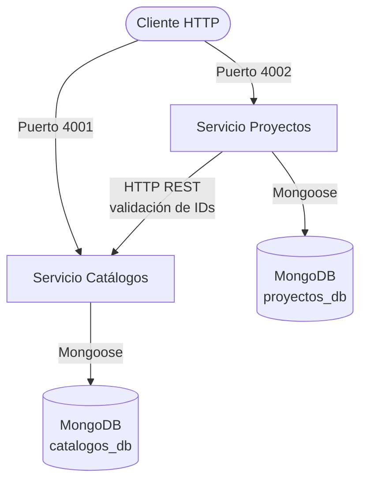

# 📘 Sistema de Gestión de Asesorías Académicas — IUDigital

> **Institución Universitaria Digital de Antioquia**
> Actividad Énfasis 2a — Tecnologías Web | Caso de Estudio 3

Sistema backend integral para la administración de proyectos de asesoría académica. Permite gestionar los catálogos institucionales y los proyectos de asesoría desde una arquitectura monolítica inicial, evolucionando hacia microservicios independientes orquestados con Docker y desplegados automáticamente mediante Jenkins.

---

## 🏗️ Stack Tecnológico

| Categoría | Tecnología | Versión |
|---|---|---|
| **Runtime** | Node.js | 20 LTS |
| **Framework Web** | Express.js | ^4.19.2 |
| **ODM / Base de Datos** | Mongoose + MongoDB | ^8.3.2 / 7.0 |
| **Contenedores** | Docker + Docker Compose | v2 |
| **Imagen base** | node:20-alpine | Alpine Linux |
| **Registro de imágenes** | Docker Hub | jorgedev/* |
| **CI/CD** | Jenkins LTS | Declarativo |
| **Comunicación inter-servicio** | axios HTTP REST | ^1.6.8 |

---

## 🗺️ Arquitecturas del Sistema

### Monolítica (Fase 1)

```mermaid
flowchart TD
    C([Cliente HTTP]) -->|Puerto 3000| M[Express App - Monolito]
    M --> TP[/api/tipos-proyecto]
    M --> CL[/api/clientes]
    M --> UN[/api/universidades]
    M --> ET[/api/etapas]
    M --> PR[/api/proyectos]
    TP & CL & UN & ET & PR -->|Mongoose| DB[(MongoDB\nasesorias_monolito_db)]
```

### Desacoplada con Microservicios (Fase 2)



---

## 🚀 Guía de Inicio Rápido

### Opción 1 — Monolito local (requiere Node.js y MongoDB instalados)

```bash
# 1. Configurar variables de entorno
cd backend-monolito && cp .env.example .env

# 2. Instalar dependencias y cargar datos de prueba
npm install && npm run seed

# 3. Iniciar el servidor
npm start
# API disponible en: http://localhost:3000
```

### Opción 2 — Monolito con Docker Compose

```bash
docker compose -f docker/docker-compose.monolito.yml up --build
# API disponible en: http://localhost:3000
```

### Opción 3 — Microservicios con Docker Compose

```bash
docker compose -f docker/docker-compose.desacoplado.yml up --build
# Catálogos en: http://localhost:4001
# Proyectos en: http://localhost:4002
```

---

## 📋 Módulos del Sistema

| Módulo | Endpoints Base | Puerto | Descripción |
|---|---|---|---|
| **TipoProyecto** | `/api/tipos-proyecto` | 3000 / 4001 | Catálogo de tipologías académicas |
| **Cliente** | `/api/clientes` | 3000 / 4001 | Estudiantes o entidades solicitantes |
| **Universidad** | `/api/universidades` | 3000 / 4001 | Instituciones universitarias |
| **Etapa** | `/api/etapas` | 3000 / 4001 | Fases de avance del proyecto |
| **Proyecto** | `/api/proyectos` | 3000 / 4002 | Núcleo transaccional del sistema |

---

## 📁 Estructura del Repositorio

```
proyecto-asesorias-iudigital/
├── backend-monolito/          # API REST monolítica (Puerto 3000)
├── backend-desacoplado/
│   ├── servicio-catalogos/    # Microservicio de catálogos (Puerto 4001)
│   └── servicio-proyectos/    # Microservicio de proyectos (Puerto 4002)
├── docker/                    # Archivos Docker Compose
│   ├── docker-compose.monolito.yml
│   ├── docker-compose.desacoplado.yml
│   └── docker-compose.cd.yml
├── jenkins/
│   ├── Jenkinsfile            # Pipeline declarativo de CD
│   └── docker-compose-jenkins.yml
├── scripts/                   # Scripts de prueba y despliegue
└── docs/                      # Documentación técnica completa
```

---

## 📚 Documentación Completa

| Manual | Contenido |
|---|---|
| [02_ARQUITECTURA.md](./02_ARQUITECTURA.md) | Diagramas y patrones de diseño |
| [03_ANALISIS_DESACOPLAMIENTO.md](./03_ANALISIS_DESACOPLAMIENTO.md) | Justificación técnica del desacoplamiento |
| [04_ENDPOINTS.md](./04_ENDPOINTS.md) | Contrato REST completo de todos los endpoints |
| [05_DOCKER_DESPLIEGUE.md](./05_DOCKER_DESPLIEGUE.md) | Guía de Docker y Docker Hub |
| [06_JENKINS_CD_PIPELINE.md](./06_JENKINS_CD_PIPELINE.md) | Configuración del pipeline Jenkins |
| [07_PRUEBAS_Y_VALIDACION.md](./07_PRUEBAS_Y_VALIDACION.md) | Pruebas funcionales y validación |
| [08_TROUBLESHOOTING.md](./08_TROUBLESHOOTING.md) | Solución de problemas frecuentes |

---

> [!TIP]
> Para el entorno de desarrollo local se recomienda tener instalado [Node.js 20 LTS](https://nodejs.org/) y [Docker Desktop](https://www.docker.com/products/docker-desktop/). Para el pipeline de Jenkins se necesita una cuenta en [Docker Hub](https://hub.docker.com/).
