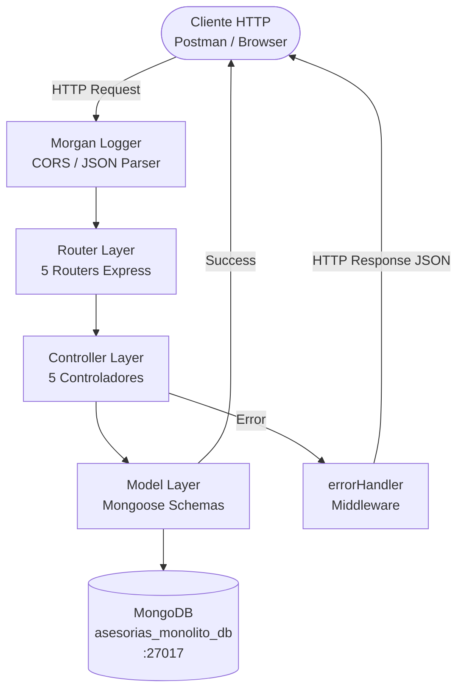
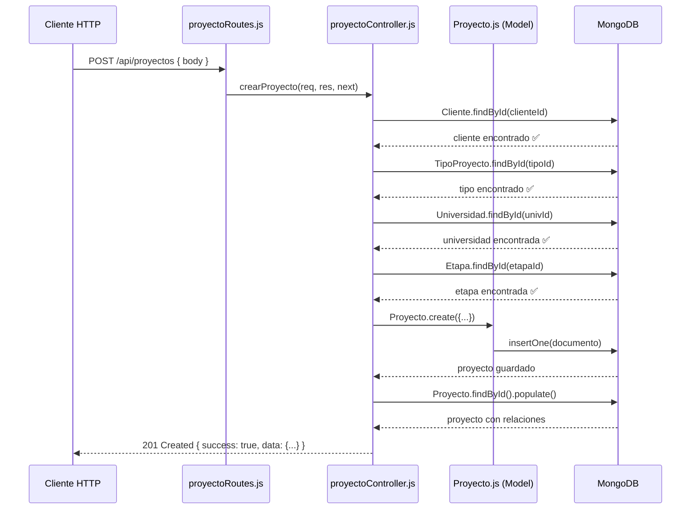
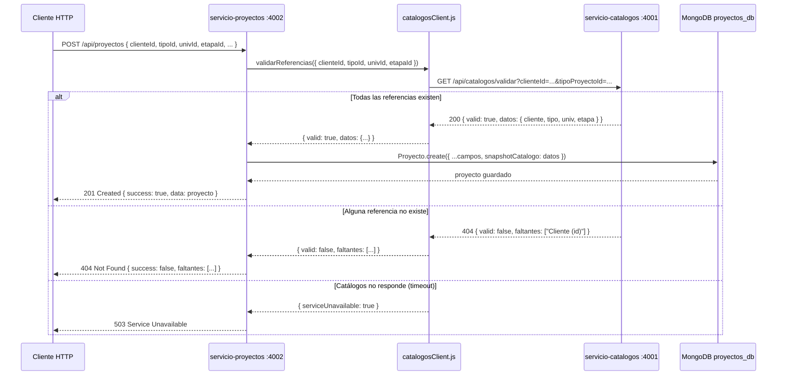
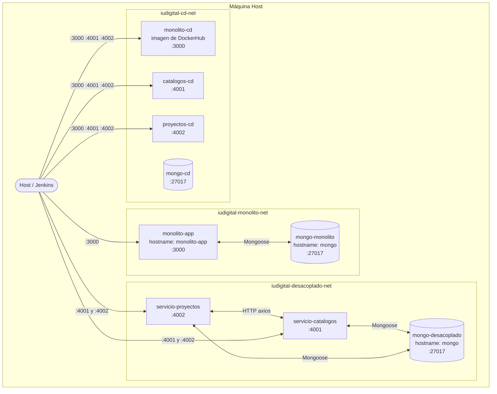
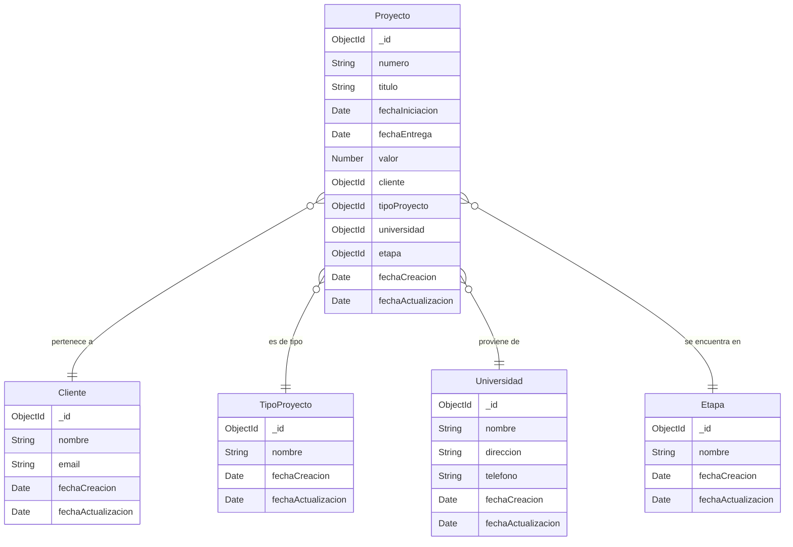

# 🏗️ Arquitectura del Sistema — IUDigital

## 1. Patrón de Diseño Aplicado

El sistema implementa el patrón **MVC (Modelo-Vista-Controlador)** adaptado a APIs REST, donde la "Vista" es la respuesta JSON entregada al cliente HTTP:

| Capa | Componente | Responsabilidad |
|---|---|---|
| **Modelo** | `src/models/*.js` | Define la estructura de datos y validaciones con Mongoose |
| **Controlador** | `src/controllers/*.js` | Contiene la lógica de negocio y orquesta la respuesta |
| **Ruta (Router)** | `src/routes/*.js` | Mapea las URLs HTTP a los controladores correspondientes |
| **Middleware** | `src/middlewares/errorHandler.js` | Captura y formatea todos los errores del sistema |

---

## 2. Arquitectura Monolítica

### Diagrama de Capas



### Flujo de una Petición POST /api/proyectos



---

## 3. Arquitectura Desacoplada (Microservicios)

### Diagrama General

```mermaid
flowchart LR
    subgraph Red Docker iudigital-desacoplado-net
        subgraph SC[Servicio Catálogos :4001]
            SC_API[Express Router]
            SC_MOD[Models: TipoProyecto\nCliente, Universidad, Etapa]
            SC_VAL[/api/catalogos/validar]
        end

        subgraph SP[Servicio Proyectos :4002]
            SP_API[Express Router]
            SP_MOD[Model: Proyecto]
            SP_CLI[catalogosClient.js\naxios + timeout 3s]
        end

        subgraph DB[MongoDB :27017]
            DBC[(catalogos_db)]
            DBP[(proyectos_db)]
        end

        SC_API --> SC_MOD --> DBC
        SP_API --> SP_MOD --> DBP
        SP_CLI -->|GET /api/catalogos/validar| SC_VAL
        SC_VAL --> SC_MOD
    end

    C([Cliente HTTP]) -->|:4001| SC_API
    C -->|:4002| SP_API
```

### Flujo de Creación de Proyecto (Desacoplado)



---

## 4. Diseño de Redes Docker

Cada entorno tiene su propia red aislada tipo `bridge`:



> [!NOTE]
> Los contenedores dentro de la misma red Docker se comunican usando el **nombre del servicio** definido en el `docker-compose.yml` como hostname. Por ejemplo, `servicio-proyectos` llama a `http://servicio-catalogos:4001` y Docker resuelve internamente la IP del contenedor.

---

## 5. Volúmenes Persistentes

Los datos de MongoDB se persisten en volúmenes Docker nombrados:

| Volumen | Usado en | Ruta en contenedor | Propósito |
|---|---|---|---|
| `mongo_monolito_data` | `docker-compose.monolito.yml` | `/data/db` | Datos del monolito |
| `mongo_desacoplado_data` | `docker-compose.desacoplado.yml` | `/data/db` | Datos de microservicios |
| `mongo_cd_data` | `docker-compose.cd.yml` | `/data/db` | Datos en entorno CD |

> [!IMPORTANT]
> Al ejecutar `docker compose down`, los contenedores se eliminan pero los **volúmenes persisten**. Para eliminar también los datos usa `docker compose down -v`.

---

## 6. Modelo de Datos (Entidad-Relación)


