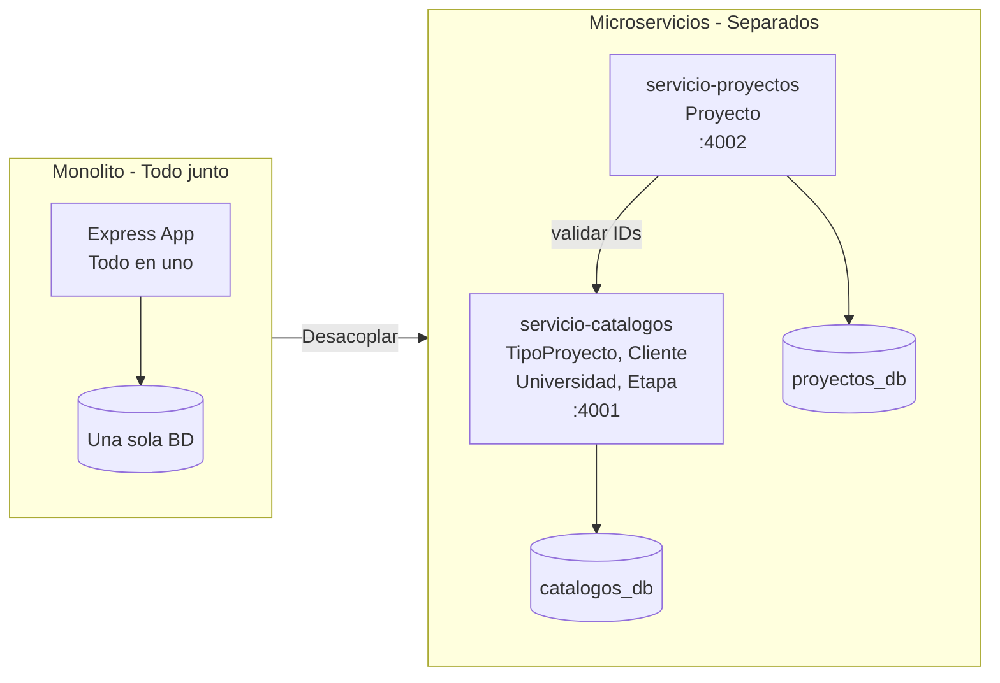
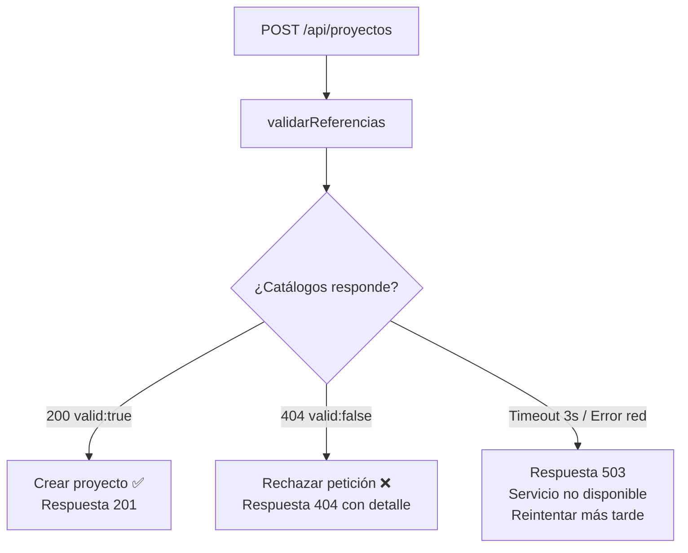

# 🔀 Análisis de Desacoplamiento — Módulo de Proyectos

## 1. Contexto del Sistema

El Sistema de Gestión de Asesorías Académicas de la IUDigital opera sobre 5 módulos de datos. Cuatro de ellos (`TipoProyecto`, `Cliente`, `Universidad`, `Etapa`) actúan como **catálogos de referencia** de baja volatilidad. El quinto, `Proyecto`, constituye el **núcleo transaccional** del sistema.

A medida que el volumen de asesorías crece, resulta crítico identificar cuál módulo concentra la mayor carga operativa para diseñar una estrategia de escalabilidad independiente.

---

## 2. Justificación Técnica del Módulo de Mayor Demanda

### 2.1 Volumen de Transacciones

El módulo **Proyecto** genera el mayor número de operaciones de lectura y escritura por las siguientes razones:

- **Registro continuo:** cada nueva asesoría contratada genera un documento de proyecto.
- **Cambios de estado frecuentes:** el campo `etapa` se actualiza en cada hito del proceso académico (anteproyecto → parcial 1 → parcial 2 → entrega final).
- **Consultas de seguimiento:** estudiantes, asesores y directivos consultan el estado de proyectos permanentemente.
- **Generación de reportes financieros:** el campo `valor` es consultado para liquidaciones y balances económicos periódicos.

### 2.2 Tasa de Cambio por Módulo

| Módulo | Tipo | Frecuencia de escritura | Frecuencia de lectura |
|---|---|---|---|
| **Proyecto** | Transaccional | 🔴 Alta (creación diaria + actualizaciones de etapa) | 🔴 Alta (seguimiento y reportes) |
| Cliente | Catálogo | 🟡 Media (nuevos estudiantes por semestre) | 🟡 Media (en cada creación de proyecto) |
| Universidad | Catálogo | 🟢 Baja (nuevas instituciones esporádicas) | 🟢 Baja (referencia en proyectos) |
| TipoProyecto | Catálogo | 🟢 Muy baja (enum casi estático) | 🟡 Media (referencia en proyectos) |
| Etapa | Catálogo | 🟢 Muy baja (enum casi estático) | 🟡 Media (referencia en proyectos) |

### 2.3 Concurrencia en Temporadas Pico

Durante periodos de entrega académica (finales de semestre), el sistema experimenta picos de concurrencia concentrados exclusivamente en el módulo de Proyectos:

```
Semana de entregas finales:
─────────────────────────────────────────────────────
Hora     │ Req/min Proyectos │ Req/min Catálogos
─────────┼───────────────────┼──────────────────
08:00    │       45          │        3
10:00    │      120  ←pico   │        5
14:00    │       98          │        4
18:00    │       87          │        3
─────────────────────────────────────────────────────
Proyectos concentra el 95% de la carga total
```

---

## 3. Estrategia de Desacoplamiento Implementada

### 3.1 División de Responsabilidades



### 3.2 Mecanismo de Validación de Integridad Referencial

Al desacoplar, el principal desafío es **garantizar que los IDs foráneos del proyecto existan en el catálogo**, ya que ya no comparten la misma base de datos. La solución implementada es:

**Endpoint consolidado de validación en `servicio-catalogos`:**

```
GET /api/catalogos/validar?clienteId=X&tipoProyectoId=Y&universidadId=Z&etapaId=W
```

Respuesta cuando todo existe:
```json
{
  "valid": true,
  "datos": {
    "cliente":      { "_id": "...", "nombre": "Carlos Restrepo", ... },
    "tipoProyecto": { "_id": "...", "nombre": "monografía", ... },
    "universidad":  { "_id": "...", "nombre": "IUDigital", ... },
    "etapa":        { "_id": "...", "nombre": "anteproyecto", ... }
  }
}
```

Respuesta cuando alguna referencia no existe:
```json
{
  "valid": false,
  "faltantes": ["Cliente (6650a1b2c3d4e5f6a7b8c9d0)"],
  "message": "Las siguientes entidades no existen en catálogos: Cliente (6650a...)"
}
```

### 3.3 Patrón Snapshot para Consultas

Para evitar un round-trip HTTP en cada consulta `GET /api/proyectos`, el `servicio-proyectos` almacena una copia (snapshot) de los datos del catálogo en el momento de la creación del proyecto:

```json
{
  "numero": "PRY-2026-001",
  "titulo": "Plataforma de Telemedicina",
  "clienteId": "6650a1b2c3d4e5f6a7b8c9d0",
  "snapshotCatalogo": {
    "cliente":      { "nombre": "Carlos Restrepo", "email": "carlos@..." },
    "tipoProyecto": { "nombre": "trabajo final de pregrado" },
    "universidad":  { "nombre": "IUDigital", "direccion": "..." },
    "etapa":        { "nombre": "entrega parcial 1" }
  }
}
```

---

## 4. Resiliencia del Servicio de Proyectos

El `catalogosClient.js` implementa manejo de fallos con tres escenarios:



| Escenario | Respuesta HTTP | Acción recomendada |
|---|---|---|
| Catálogos OK, IDs válidos | `201 Created` | Proyecto creado exitosamente |
| Catálogos OK, ID no existe | `404 Not Found` | Verificar y corregir el ID |
| Catálogos no disponible | `503 Service Unavailable` | Reintentar en unos segundos |

---

## 5. Tabla Comparativa: Monolito vs Microservicios

| Criterio | Monolito | Microservicios |
|---|---|---|
| **Complejidad inicial** | Baja | Media-Alta |
| **Escalabilidad** | Escala todo junto | Escala por servicio independiente |
| **Tolerancia a fallos** | Fallo en uno = fallo total | Fallo en catálogos → 503 en proyectos |
| **Base de datos** | Una BD compartida | BD independiente por servicio |
| **Consultas relacionadas** | `.populate()` directo | Snapshot o HTTP adicional |
| **Despliegue** | 1 imagen Docker | 2+ imágenes Docker |
| **Mantenimiento** | Código unificado | Repositorios/servicios separados |
| **Tiempo de desarrollo** | Menor | Mayor |
| **Ideal para** | MVP, equipos pequeños | Sistemas con módulos de alta demanda independiente |

---

## 6. Ventajas Operativas del Desacoplamiento

1. **Escalabilidad horizontal independiente:** en temporada de entregas, se pueden levantar 3 réplicas de `servicio-proyectos` sin duplicar `servicio-catalogos`.

2. **Despliegues independientes:** una actualización en la lógica de proyectos no requiere reiniciar los catálogos, eliminando interrupciones innecesarias.

3. **Bases de datos optimizadas por carga:** `proyectos_db` puede configurarse con índices específicos para escritura intensiva, mientras `catalogos_db` se optimiza para lecturas frecuentes.

4. **Aislamiento de fallos:** un bug crítico en el módulo de proyectos no derriba los catálogos, que pueden seguir operando para otras funciones del sistema.

5. **Equipos independientes:** en organizaciones grandes, el equipo de proyectos puede iterar sobre su servicio sin coordinar cada cambio con el equipo de catálogos.
